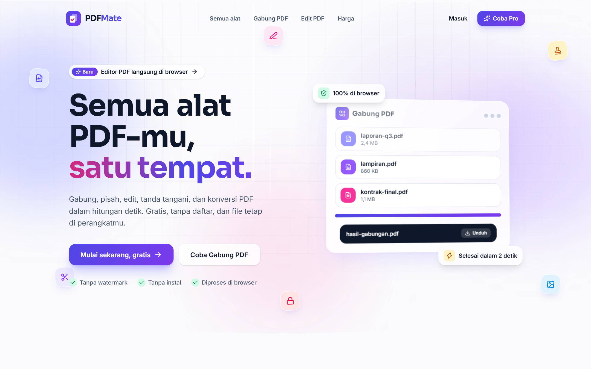
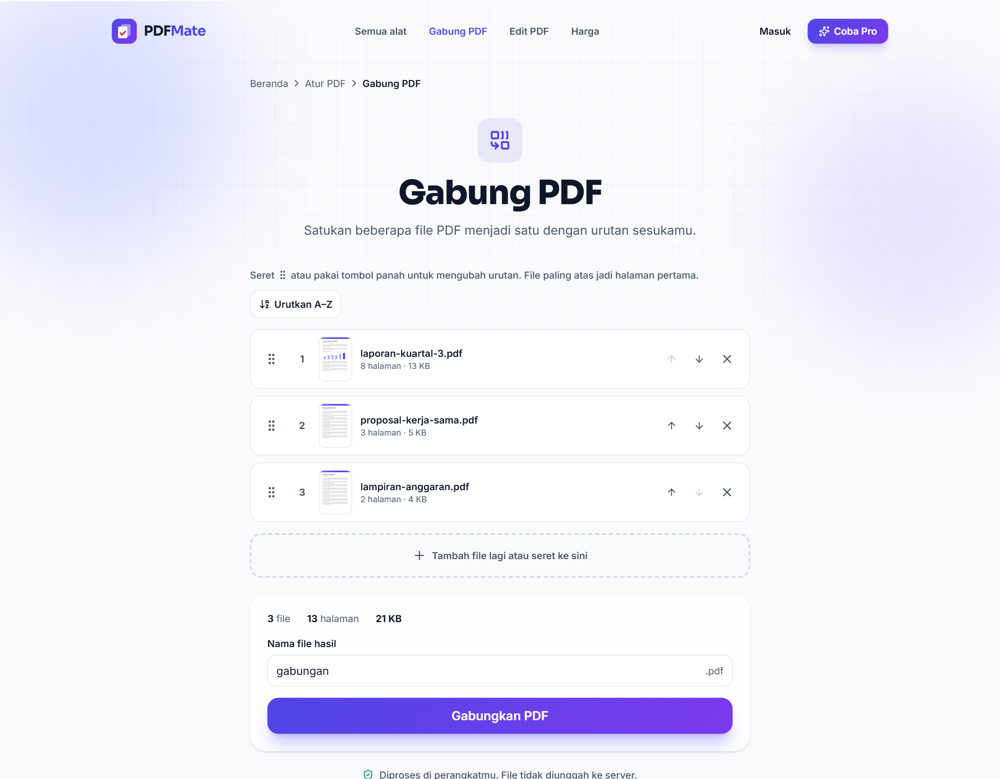
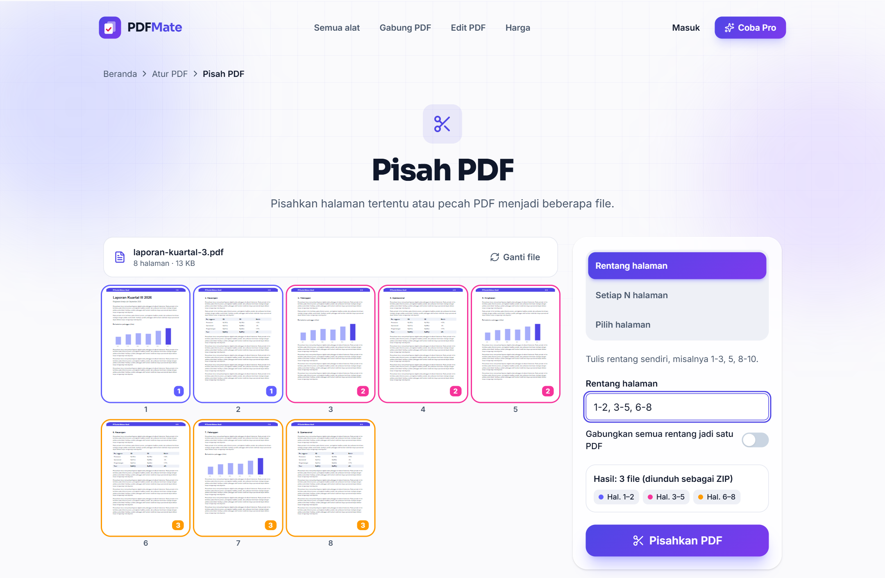
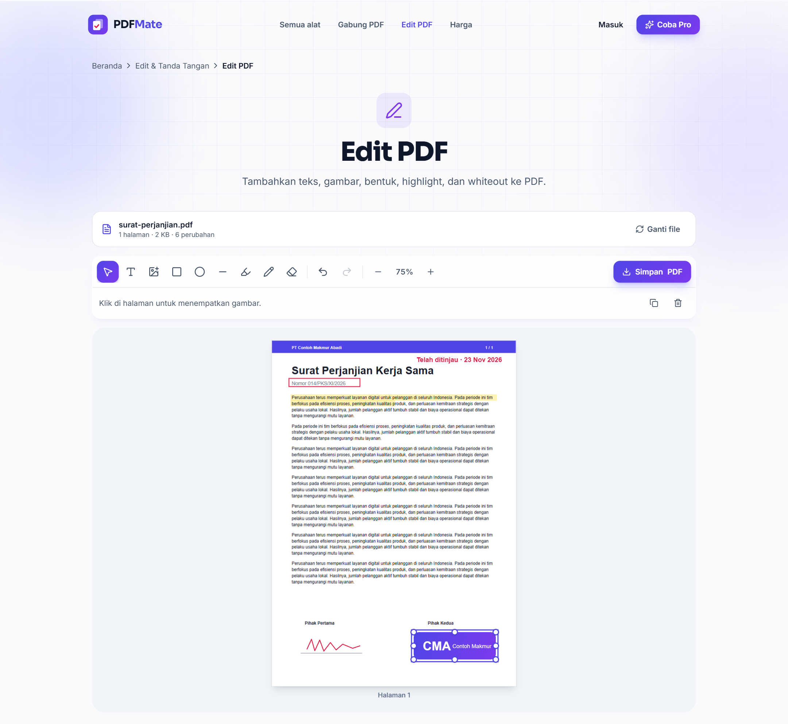
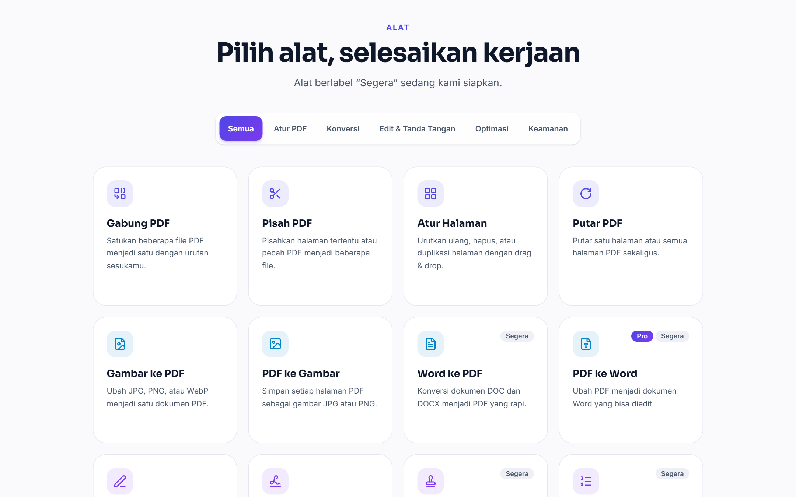
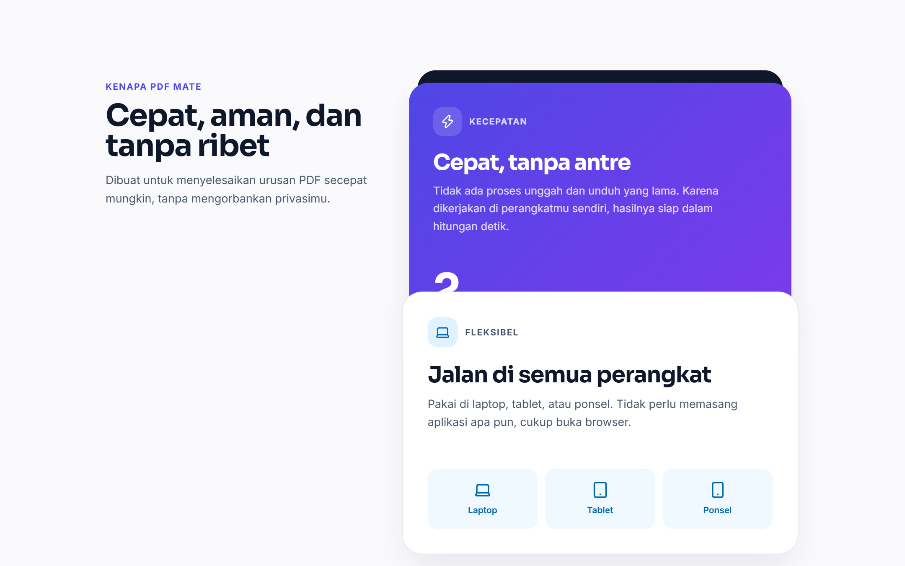
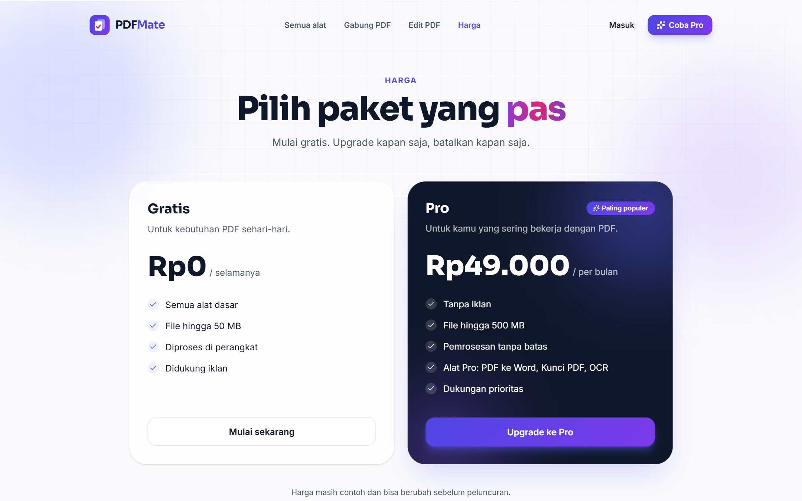
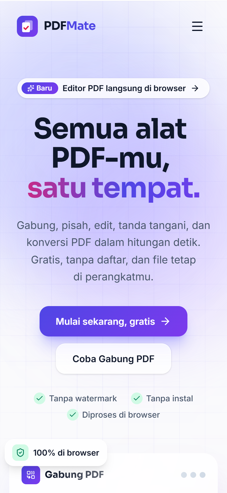
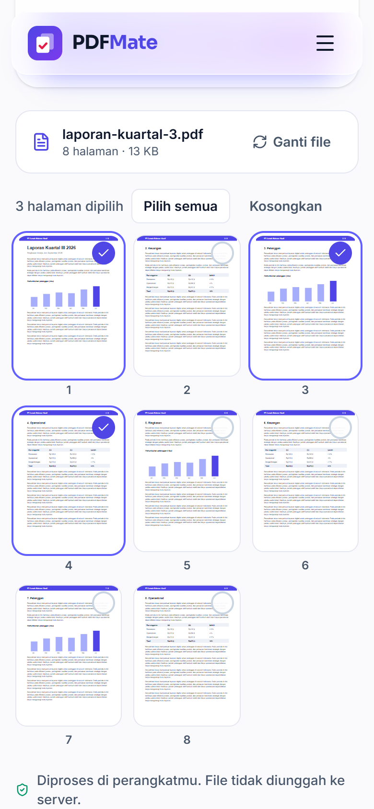

<div align="center">

# PDF Mate

**Semua alat PDF-mu, satu tempat.**

Gabung, pisah, dan edit PDF langsung di browser. Tanpa daftar, tanpa watermark, dan file tidak pernah diunggah ke server.

[](https://github.com/ryanmhildan/pdf-mate/actions/workflows/ci.yml)


[Tangkapan layar](#tangkapan-layar) · [Fitur](#fitur) · [Tech stack](#tech-stack) · [Memulai](#memulai) · [Arsitektur](#arsitektur) · [Roadmap](#roadmap)

<br />



</div>

---

## Tentang

PDF Mate adalah kumpulan alat PDF online seperti layanan PDF populer, dengan satu perbedaan penting: **semua pemrosesan terjadi di perangkat pengguna**. PDF dibaca, digabung, dipisah, dan diedit oleh JavaScript di browser, jadi kontrak, slip gaji, atau dokumen pribadi lainnya tidak pernah meninggalkan laptop atau ponsel penggunanya. Tidak ada server pemroses, tidak ada antrean, dan tidak ada biaya penyimpanan file.

Proyek ini dibangun sebagai portofolio sekaligus produk yang bisa dimonetisasi: paket gratis dengan ruang iklan, dan paket Pro untuk fitur yang lebih berat.

> **Coba langsung.** Jalankan `npm install` lalu `npm run dev`, buka `http://localhost:3456`, dan seret PDF apa pun ke salah satu alat. Tidak perlu database, akun, atau environment variable.

## Tangkapan layar

<table>
  <tr>
    <td width="50%"></td>
    <td width="50%"></td>
  </tr>
  <tr>
    <td align="center"><b>Gabung PDF</b>: atur urutan dengan seret atau tombol panah, lalu unduh satu file.</td>
    <td align="center"><b>Pisah PDF</b>: tiap halaman diberi warna sesuai file hasilnya sebelum diproses.</td>
  </tr>
  <tr>
    <td colspan="2"></td>
  </tr>
  <tr>
    <td colspan="2" align="center"><b>Edit PDF</b>: tambah teks, gambar, bentuk, highlight, coretan bebas, dan whiteout, lalu tanam permanen ke file.</td>
  </tr>
  <tr>
    <td></td>
    <td></td>
  </tr>
  <tr>
    <td align="center"><b>Daftar alat</b> dengan filter kategori beranimasi.</td>
    <td align="center"><b>Kartu fitur</b> yang menumpuk saat halaman di-scroll.</td>
  </tr>
  <tr>
    <td colspan="2"></td>
  </tr>
  <tr>
    <td colspan="2" align="center"><b>Halaman harga</b>: paket Gratis dengan iklan dan paket Pro.</td>
  </tr>
</table>

<p align="center">
  
  &nbsp;&nbsp;
  
</p>
<p align="center"><b>Di ponsel</b>, opsi pindah ke atas dan grid halaman menyesuaikan lebar layar.</p>

## Fitur

### Alat yang sudah berfungsi

- **Gabung PDF.** Unggah hingga 20 PDF, lihat thumbnail halaman pertama dan jumlah halamannya, lalu atur urutan dengan drag & drop, tombol panah (bisa lewat keyboard), atau *Urutkan A–Z*. PDF yang rusak atau terkunci kata sandi ditandai dan mengunci tombol gabung sampai file itu dihapus. Nama file hasil bisa diatur, dan karakter yang tidak boleh ada di nama file dibersihkan otomatis.
- **Pisah PDF** dengan tiga mode:
  - *Rentang halaman*: tulis `1-3, 5, 8-10`. Spasi, tanda –, dan rentang terbalik diterima, dan input yang salah langsung diberi pesan yang jelas ("Halaman 12 tidak ada. Dokumen ini hanya punya 10 halaman."). Semua rentang bisa digabung jadi satu PDF.
  - *Setiap N halaman*: pecah dokumen per sekian halaman.
  - *Pilih halaman*: klik thumbnail, lalu simpan sebagai satu PDF atau satu file per halaman.

  Hasil lebih dari satu file diunduh sebagai ZIP, dan setiap file juga bisa diunduh satu per satu.
- **Edit PDF**, editor overlay dengan sembilan alat:

  | Alat | Shortcut | Keterangan |
  |---|---|---|
  | Pilih & geser | `V` | Pindah, ubah ukuran dengan 8 titik pegangan (gambar tetap proporsional) |
  | Teks | `T` | Multi-baris; font Sans/Serif/Mono, 8–72 pt, tebal, warna |
  | Gambar | `I` | JPG, PNG, WebP, GIF (WebP dan GIF dikonversi ke PNG) |
  | Kotak, Elips, Garis | `R` `E` `L` | Warna garis, ketebalan, dan warna isi |
  | Highlight | `H` | Empat warna, berbaur dengan teks di bawahnya (*multiply*) |
  | Coret bebas | `D` | Untuk paraf atau tanda tangan cepat |
  | Whiteout | `W` | Menutup bagian halaman dengan warna putih |

  Dilengkapi undo/redo (`Ctrl+Z`, `Ctrl+Y`), duplikat (`Ctrl+D`), hapus (`Delete`), geser per 1 pt atau 10 pt dengan tombol panah, zoom yang menyesuaikan lebar layar, dan peringatan sebelum meninggalkan halaman dengan perubahan yang belum disimpan.

### Privasi dan performa

- **Tanpa unggahan.** Tidak ada endpoint yang menerima file. PDF dibaca dengan `File.arrayBuffer()` dan diproses di browser.
- **Ringan untuk dokumen panjang.** Thumbnail dan halaman editor hanya dirender saat mendekati layar (IntersectionObserver), satu per satu lewat antrean, supaya scroll tetap mulus.
- **Memori dibersihkan.** Setiap thumbnail dan file hasil adalah *object URL* yang dicatat lalu dilepas saat diganti atau saat alat ditutup.

### Pengalaman pengguna

- Desain glassmorphism terang dengan gradasi indigo–violet, font Sora dan Inter.
- Animasi dengan [Motion](https://motion.dev): judul hero muncul kata per kata, hero bereaksi terhadap gerakan kursor (kemiringan 3D, ikon melayang, cahaya), demo Gabung PDF yang berulang, filter kategori dengan pil yang bergeser, dan kartu fitur yang menumpuk saat di-scroll. Semua animasi dimatikan saat pengguna mengaktifkan *reduce motion*.
- Aksesibel: link *Lewati ke konten*, fokus keyboard yang terlihat, label untuk tombol ikon, dan `aria-live` untuk status proses.
- Responsif dari ponsel sampai desktop tanpa scroll horizontal.

### Siap dimonetisasi

- Komponen `AdSlot` dengan tinggi tetap, sehingga iklan tidak menggeser tata letak saat dimuat.
- Halaman harga Gratis vs Pro, dan label *Pro* atau *Segera* di setiap alat, diatur dari satu file: [`src/lib/tools.ts`](src/lib/tools.ts).

## Tech stack

| Lapisan | Teknologi |
|---|---|
| Framework | Next.js 16 (App Router, Cache Components, Turbopack) |
| UI | React 19, Tailwind CSS 4, Motion, Lucide |
| Bahasa | TypeScript (strict) |
| Membaca & merender PDF | pdf.js 6 (`pdfjs-dist`) dengan web worker |
| Menulis PDF | pdf-lib |
| ZIP | fflate |
| CI | GitHub Actions: lint, typecheck, build |

## Memulai

### Prasyarat

- Node.js 20.9 atau lebih baru (CI memakai Node 24)

### Instalasi

```bash
# 1. Clone repo
git clone https://github.com/ryanmhildan/pdf-mate.git
cd pdf-mate

# 2. Install dependensi (otomatis menyalin worker pdf.js ke public/)
npm install

# 3. Jalankan server development
npm run dev
```

Buka [http://localhost:3456](http://localhost:3456). Tidak ada environment variable yang perlu diisi.

### Script

| Perintah | Fungsi |
|---|---|
| `npm run dev` | Menjalankan server development di port 3456 |
| `npm run build` | Build untuk produksi |
| `npm start` | Menjalankan hasil build di port 3456 |
| `npm run lint` | ESLint |
| `npm run typecheck` | Membuat tipe route Next.js lalu memeriksa TypeScript |

## Arsitektur

```
src/
├── app/
│   ├── [tool]/page.tsx        # satu halaman dinamis untuk semua alat (/gabung-pdf, /pisah-pdf, /edit-pdf, …)
│   ├── harga/                 # halaman harga
│   ├── layout.tsx             # font, header, footer, MotionProvider
│   └── page.tsx               # landing page
├── components/
│   ├── tools/
│   │   ├── merge-tool.tsx     # Gabung PDF
│   │   ├── split-tool.tsx     # Pisah PDF
│   │   ├── edit-tool.tsx      # Edit PDF: memuat file, zoom, shortcut, simpan
│   │   ├── edit/              # halaman editor, objek, toolbar, riwayat undo/redo
│   │   └── shared.tsx         # overlay progres, kartu hasil, banner error
│   ├── upload-area.tsx        # area unggah drag & drop dengan validasi tipe dan ukuran
│   ├── hero.tsx               # hero yang bereaksi terhadap kursor
│   └── stacking-features.tsx  # kartu fitur yang menumpuk saat di-scroll
└── lib/
    ├── tools.ts               # daftar alat, kategori, status (siap / segera / Pro)
    └── pdf/                   # logika PDF murni, tanpa React
        ├── inspect.ts         # buka PDF dengan pdf.js, render halaman, geometri halaman
        ├── merge.ts           # gabung dengan pdf-lib
        ├── split.ts           # pisah + ZIP
        ├── ranges.ts          # parser rentang halaman ("1-3, 5, 8-10")
        ├── edit.ts            # tanam objek editor ke PDF
        └── matrix.ts          # matriks transformasi koordinat
scripts/
└── copy-pdf-worker.mjs        # menyalin worker pdf.js ke public/ saat npm install
```

### Keputusan desain

- **Logika PDF terpisah dari UI.** Semua file di `lib/pdf/` tidak mengimpor React, sehingga bisa dijalankan dan diuji langsung di Node. Komponen hanya mengatur state dan tampilan.
- **Koordinat yang benar untuk halaman diputar.** Editor menyimpan posisi objek dalam ruang "halaman seperti yang terlihat" (titik, origin kiri atas). Saat menyimpan, `drawingToPdf()` membalik matriks viewport pdf.js, lalu menggabungkannya dengan pembalikan sumbu Y. Hasilnya, teks tetap tegak dan tepat posisinya pada halaman yang diputar 90°, 180°, atau 270°, dan pada halaman dengan MediaBox yang tidak dimulai dari (0, 0).
- **Konten asli diisolasi.** Sebelum menggambar, isi halaman dibungkus `q … Q`. Dengan begitu, PDF yang graphics state-nya tidak seimbang tidak bisa menggeser objek baru.
- **Penyimpanan tidak pernah gagal karena karakter.** Font standar PDF hanya mendukung Latin (WinAnsi). Karakter yang tidak didukung, seperti emoji, diganti `?` per karakter, bukan membuat seluruh proses gagal.
- **Metrik teks disamakan dengan browser.** Posisi baseline memakai metrik Arial, Times New Roman, dan Courier New dengan `line-height` 1,2, sehingga teks di PDF hasil sama letaknya dengan yang terlihat di editor.
- **Worker pdf.js mengikuti versi library.** Worker disalin dari `node_modules` saat `npm install`, bukan di-commit, supaya versinya tidak pernah berbeda dari `pdfjs-dist`.
- **ZIP tanpa kompresi ulang.** PDF sudah terkompresi, jadi file di ZIP disimpan apa adanya (level 0) agar cepat.

> **Catatan:** whiteout hanya menutup secara visual. Teks asli di bawahnya masih ada di dalam file. Untuk menyembunyikan data sensitif dibutuhkan redaksi sungguhan (lihat roadmap).

## Roadmap

- [ ] Atur halaman, Putar PDF, Gambar ke PDF, dan PDF ke Gambar (di browser)
- [ ] Tanda tangan PDF dengan kanvas tanda tangan yang bisa disimpan
- [ ] Redaksi yang benar-benar menghapus teks di bawahnya
- [ ] Unit test (Vitest) untuk `lib/pdf/` dan test end-to-end (Playwright)
- [ ] Kompres, Word ↔ PDF, dan OCR di server (paket Pro)
- [ ] Akun, pembayaran paket Pro, dan iklan sungguhan untuk paket Gratis
